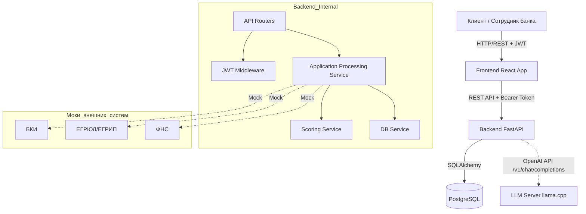

# Архитектура решения

## Общая схема
Решение построено по принципу Cloud-Native и разворачивается через `docker-compose`. Оно состоит из четырех основных сервисов:
1. **Frontend (React + Vite)** — SPA-приложение для клиента и банковских сотрудников.
2. **Backend (FastAPI)** — ядро системы, реализующее бизнес-логику, скоринг и JWT-авторизацию.
3. **Database (PostgreSQL 16)** — реляционное хранилище.
4. **LLM (llama.cpp, опционально)** — локальный сервер с моделью `t-lite-it-2.1` (запускается отдельным профилем).

## Компоненты бэкенда
- **API Layer (`app/api`):** Роутеры FastAPI. Включает `applications.py` (жизненный цикл заявки), `products.py`, `businesses.py`, `authorization.py` (JWT-вход), `explain.py` (ИИ-объяснения).
- **Service Layer (`app/services`):**
  - `application_processing.py`: Оркестратор конвейера обработки заявки (вызов проверок, скоринга и смена статусов).
  - `state_machine.py`: Декларативное описание разрешенных переходов между статусами.
  - `scoring.py`: Детерминированная балльная модель оценки риска.
  - `external_checks.py`: Моки для запросов во внешние системы.
  - `llm.py`: Клиент для взаимодействия с LLM (health check, кэширование, защита от галлюцинаций).
- **Data Layer (`app/models.py`, `app/database.py`):** ORM-модели SQLAlchemy и сессии подключения к БД.

## Безопасность и JWT
- Вход осуществляется через эндпоинт `POST /auth/demo-login`, который выдает JWT-токен (алгоритм HS256, срок жизни 15 минут).
- Фронтенд сохраняет токен в `localStorage` и передает его в заголовке `Authorization: Bearer <token>` при каждом запросе.
- Эндпоинт `GET /auth/me` возвращает профиль текущего пользователя на основе токена.
- Для доступа к защищенным эндпоинтам используется зависимость `get_current_entrepreneur` в `app/api/dependencies.py`.

## Особенности LLM-интеграции
- **Безопасность:** В промпт передаются только факты из БД (числа, статусы), свободный текст пользователя (например, цель кредита) блокируется. Модель не принимает решений.
- **Отказоустойчивость:** Если контейнер `llm` не запущен или модель загружается, бэкенд возвращает fallback-ответ (шаблонный текст). Основной кредитный сценарий не блокируется.
- **Совместимость:** Используется стандартный OpenAI-совместимый протокол (`/v1/chat/completions`). Переменные `LLM_URL`, `LLM_MODEL` позволяют легко заменить провайдера.
- **Статус в MVP:** Модуль полностью реализован на уровне бэкенда и доступен через Swagger UI. Интеграция в клиентский интерфейс (Frontend) вынесена в Roadmap из-за тайминга хакатона.