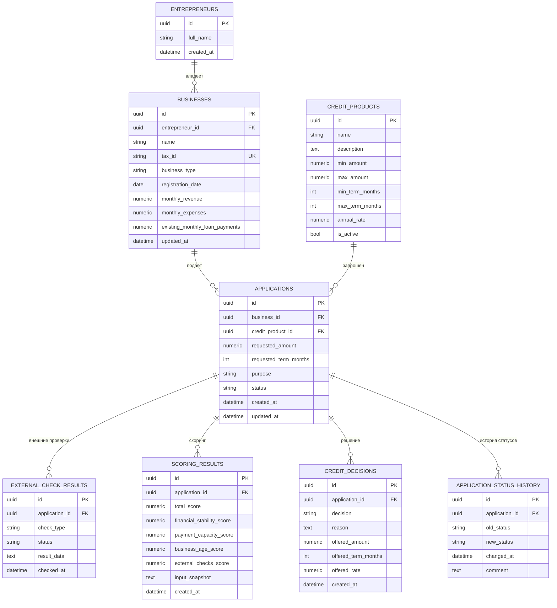

# Модель данных (ER)

СУБД: PostgreSQL 16. ORM: SQLAlchemy. Все ID — UUID. Денежные суммы — `NUMERIC(15,2)`, баллы и ставки — `NUMERIC(5,2)`.

## Описание сущностей
- **`entrepreneurs`**: Предприниматель (ФИО).
- **`businesses`**: Бизнес (ИНН, выручка, расходы, текущие платежи). Связан с предпринимателем.
- **`credit_products`**: Каталог продуктов с валидацией диапазонов сумм и сроков (CHECK constraints).
- **`applications`**: Ядро системы. Хранит параметры заявки и текущий статус. Связана с продуктом и бизнесом (используются `relationship` для подгрузки имени продукта).
- **`application_status_history`**: Аудит переходов статусов (заполняется автоматически при смене статуса).
- **`scoring_results`** и **`credit_decisions`**: Разделяют оценку риска и итоговое решение банка.