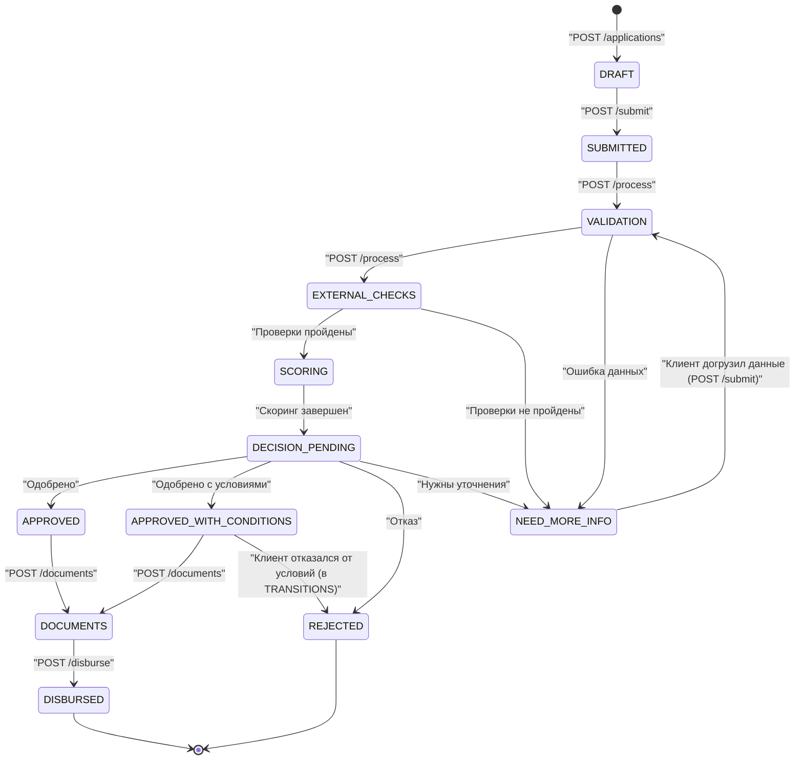

# Машина состояний заявки

Источник истины: `backend/app/services/state_machine.py` (словарь `TRANSITIONS`).
Каждый переход статуса логируется в таблицу `application_status_history`.

## Диаграмма состояний

## Статусы заявки

| Статус | Описание | Кто и чем переводит |
|---|---|---|
| `DRAFT` | Черновик заявки создан, не отправлен | Клиент, `POST /applications/` |
| `SUBMITTED` | Заявка отправлена клиентом | Клиент, `POST /applications/{id}/submit` |
| `VALIDATION` | Первичная проверка данных | Система, `POST /applications/{id}/process` |
| `EXTERNAL_CHECKS` | Запуск моков внешних проверок (БКИ, ЕГРЮЛ, ФНС) | Система |
| `SCORING` | Расчет скорингового балла | Система |
| `DECISION_PENDING` | Подготовка кредитного решения | Система |
| `APPROVED` | Одобрено на запрошенных условиях | Система |
| `APPROVED_WITH_CONDITIONS` | Одобрено с изменением суммы/срока | Система |
| `NEED_MORE_INFO` | Требуются уточнения (не пройдены проверки) | Система |
| `REJECTED` | Отказ (конечный статус) | Система или клиент |
| `DOCUMENTS` | Оформление и подписание документов | Клиент, `POST /applications/{id}/documents` |
| `DISBURSED` | Средства выданы (моделируемая выдача, конечный статус) | Банк/Система, `POST /applications/{id}/disburse` |

## Особенности реализации
- В файле `state_machine.py` жестко заданы разрешенные переходы (`assert_transition`). Недопустимый переход вызовет ошибку `ValueError`.
- Функция `transition_application` (в `application_service.py`) инкапсулирует смену статуса и автоматически создает запись в истории `ApplicationStatusHistory`.
- Вся логика обработки вынесена в сервис `application_processing.py`, который вызывается через эндпоинт `POST /process`.
- Эндпоинт `POST /submit` не только переводит заявку в `SUBMITTED`, но и сразу автоматически запускает конвейер обработки (вызывает `process_application_service`).
- *Примечание:* Переход `APPROVED_WITH_CONDITIONS -> REJECTED` (клиент отказался от условий) описан в `TRANSITIONS`, но пока не имеет отдельного API-эндпоинта.